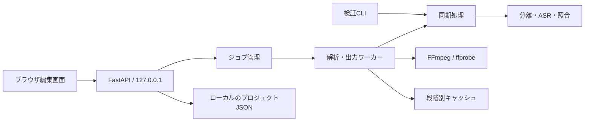

# Lyric Studio 基本設計書

v1.0.0 / [仕様と変更管理 #1](https://github.com/sutonomega/lyric-studio/issues/1)

## システム構成

Phase 1はCLIで音声、歌詞、設定を受け、同期JSONとSRTを生成する。Phase 2で同じ同期処理にローカルAPIと編集画面を接続する。モデルや前処理の違いはアダプターで吸収し、比較条件を設定で切り替える。



本番用ビルドはAPIと静的画面を同一オリジンで提供する。ブラウザから選択した素材はローカルAPIへ転送し、作業用領域へストリーム保存する。APIには素材IDを渡す。ループバックへ限定して起動し、Host・Originと変更リクエストを検証する。モデルの取得はセットアップ時に行い、実行時は取得済みのモデルを読み込む。

## 音声・ジョブ

1. ffprobeでストリーム・長さ・開始時刻を取得する。動画または音声の先頭をプロジェクトの0msとし、MP4の開始PTSや音声オフセットを解析・再生・出力で揃える。分離にはモデルの要求する形式を使い、ASRには共通条件の16 kHzモノラルPCMを供給する。
2. 原音または分離ボーカルから時刻付き認識候補を作る。照合は認識候補と歌詞行を受け、元の歌詞、開始・終了の候補、要確認の理由を返す。
3. 時間のかかる処理は Windows の別プロセスで実行する。GPUジョブの同時実行は初期案で1件。状態は queued、running、cancelling、cancelled、succeeded、failed。進捗は工程名と計測可能な工程の割合を返す。初期UIはポーリングで取得する。
4. ジョブは素材・設定・開始時のプロジェクトリビジョンを固定する。完了結果は候補として受け取り、編集中の内容への適用をユーザーが選べる。キャンセル時はワーカーと必要な子プロセスの終了を確認し、一時成果を破棄する。GPU不可の場合は理由を示し、CPUで再実行できる。中断したジョブは再起動時に検出し、公開済みキャッシュを再利用する。

## データと時刻

| データ | 主な項目と規則 |
| --- | --- |
| Project | schemaVersion、projectId、revision、素材IDと相対パス、素材ハッシュ、durationMs、字幕一覧、スタイル、出力設定。素材を移動した場合は同一ハッシュで再リンクできる設計とする。 |
| LyricLine / Cue | 一意の行ID、入力順、表示文、startMs/endMs、状態、根拠、手動更新。繰り返しは別の行ID。正規化文字列は照合用データに保持する。未配置は両時刻をnullにし、有効区間は 0 ≤ startMs < endMs ≤ durationMs。区間の終端は含めない。 |
| Style | フォントファミリーと解決済みフォントの識別、サイズ、色・透明度、縁取り・影、文字間隔・行間隔、位置、フェード、基準解像度。 |
| Job / Cache | 入力リビジョン、設定、進捗、終了理由、成果パス。デコード・分離・ASR・照合を個別にキャッシュし、入力ハッシュ、各工程の設定・版・モデル版をキーにする。照合には歌詞ハッシュも含める。 |

プロジェクトJSONは単一の書き込み経路でリビジョンを確認し、同一ボリューム上の一時ファイルから置換する。手動保存と自動保存を直列化し、旧版の移行と復元を検証する。キャッシュと書き出しも完了後に確定する。既存出力と衝突した場合は別名を選べるようにする。

## 編集画面・API

上部に素材・解析・書き出し、中央左にプレビュー、中央右に歌詞・時刻とデザイン、下部に波形・タイムライン・再生操作を配置する。ブラウザのメディア時刻を再生の基準とし、波形用ピークはサーバーで生成する。Undo/Redoはリビジョンに対応する編集コマンドを使い、ドラッグ完了や一括シフトを1操作にまとめる。初期案では編集時の重複を警告し、同時歌唱のレイヤー仕様は後から決める。

| API候補 | 用途 |
| --- | --- |
| POST /api/projects、GET/PATCH /api/projects/{id} | 作成、読込、リビジョン付き保存。競合を検出する。 |
| POST /api/projects/{id}/assets、GET /api/assets/{id}/media、GET /api/assets/{id}/peaks | 素材登録、Range対応プレビュー、波形。ブラウザで再生できないコーデックはプレビュー用プロキシを生成する。 |
| POST /api/projects/{id}/jobs、GET /api/jobs/{id}、POST /api/jobs/{id}/cancel | 開始、進捗・結果取得、キャンセル。解析結果と出力は別のジョブ種別。 |

## 字幕と動画出力

内部とSRTはミリ秒。ASSは10ms刻みへ量子化し、最短区間と素材長を検証する。MP4はFFmpeg/libassによるASS字幕の焼き込み、H.264/AACを候補とする。初期リサイズ案は縦横比を保って中央に配置する余白方式。表示位置とフォントは書き出し解像度に合わせ、入力本文をASS制御文字から分離して直列化する。行間隔は必要に応じてASSイベントの位置指定で表現する。ブラウザのライブ描画を用い、代表フレームのFFmpeg出力との比較で改行・位置・フェード・日本語フォントの差を確認する。未配置行を含む場合は行数を表示し、修正または承知のうえで配置済み行だけ出力できるようにする。[FFmpeg フィルター](https://ffmpeg.org/ffmpeg-filters.html#subtitles-1)

## ディレクトリ構成

```text
lyric-studio/
  docs/                    要求・設計・選定・検証計画
  backend/
    pyproject.toml
    src/lyric_studio/
      cli/                 Phase 1 の実行入口
      domain/              歌詞行・字幕・時刻・プロジェクト
      sync/                正規化・照合・品質判定
      adapters/            FFmpeg・分離・認識・強制アライメント
      jobs/                ワーカーと進捗・中断
      storage/             保存・キャッシュ
      export/              SRT・ASS・MP4
      api/                 Phase 2 のHTTP入口
    tests/                 単体・結合・合成素材
  frontend/                Phase 2 から追加
    src/
      editor/
      player/
      timeline/
      api/
  scripts/                 Windows セットアップ・診断・評価実行
```

個人素材と実測出力はGit管理外。初期案ではキャッシュを `%LOCALAPPDATA%\LyricStudio`、プロジェクトと書き出しをユーザー選択のフォルダに保存する。
